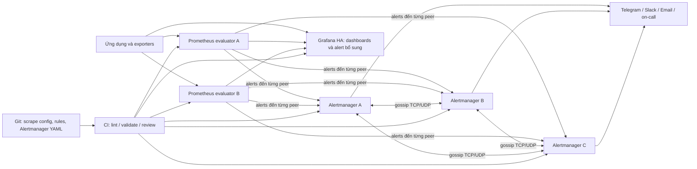

# Đánh giá kiến trúc cảnh báo: Prometheus Alertmanager và Grafana Alerting

**Đối tượng:** Tech Lead, System Architect và nhóm vận hành  
**Phạm vi:** So sánh trách nhiệm, HA và quản lý cấu hình; đề xuất kiến trúc production cho hệ Prometheus/Grafana. Đây là tài liệu phân tích, không phải thay đổi cấu hình hoặc triển khai HA.

## 1. Hiện trạng workspace

Khảo sát `docker-compose.yml`, `prometheus/prometheus.yml`, provisioning Grafana và trạng thái runtime tại thời điểm đánh giá:

- Compose hiện chạy `prometheus`, `grafana` và `node-exporter`; cả ba đang ở cùng một Compose stack/mạng mặc định.
- Prometheus scrape chính nó và Node Exporter. Chưa có file alert rules, cấu hình `alerting.alertmanagers`, service Alertmanager hoặc file cấu hình Alertmanager trong workspace.
- Prometheus API báo `activeAlertmanagers` rỗng; do đó hiện không có Alertmanager nhận alert từ Prometheus.
- Grafana được provision datasource và dashboard. Không tìm thấy rule cảnh báo Grafana trong file của project; kiểm tra API provisioning alert rules tại thời điểm khảo sát cũng không cho thấy rule nào được cấu hình.
- Không có bằng chứng về Prometheus/Grafana/Alertmanager replica, cluster hoặc notification receiver đã được cấu hình. Đây là stack học tập/local, không thể xem là triển khai HA.

Kết luận hiện trạng chỉ dựa trên Compose, file cấu hình trong workspace và các API/runtime đã kiểm tra. Không suy diễn rằng Alertmanager hoặc quy trình gửi thông báo đang hoạt động.

## A. Rủi ro Single Point of Failure (SPOF)

Pipeline cảnh báo gồm các trách nhiệm khác nhau:

1. **Đánh giá điều kiện:** Prometheus đánh giá Prometheus alerting rules; trong Grafana Alerting, scheduler của Grafana đánh giá các Grafana-managed rules (hoặc datasource-managed rules có thể được đánh giá ở hệ thống datasource tương ứng).
2. **Định tuyến và gửi thông báo:** Alertmanager nhận alert, nhóm và định tuyến theo receiver. Grafana Alerting có lớp Alertmanager riêng cho notification policies/contact points; cũng có thể cấu hình các đường tích hợp khác.
3. **Quan sát:** Grafana dashboard là giao diện truy vấn/hiển thị. Dashboard không tự thay thế rule evaluator hoặc notification pipeline chỉ vì có biểu đồ.

Nếu một máy Grafana lỗi do hết RAM, mất mạng hoặc lỗi ứng dụng:

- **Rule được đánh giá duy nhất bởi Grafana instance bị lỗi:** scheduler trên instance đó không đánh giá được trong thời gian ngừng hoạt động; Grafana-managed notification pipeline trên instance đó cũng có thể bị gián đoạn. Prometheus tiếp tục scrape/đánh giá các Prometheus rules độc lập, nếu Prometheus còn hoạt động.
- **Prometheus đã đánh giá rule và gửi đến Alertmanager độc lập:** nếu Prometheus, đường mạng và cụm Alertmanager còn khỏe, pipeline cảnh báo đó không phụ thuộc giao diện Grafana; Alertmanager vẫn có thể định tuyến và gửi notification.
- **Grafana HA:** sự cố một Grafana node không nhất thiết làm dừng Grafana Alerting. Với cấu hình HA được hỗ trợ, các instance Grafana còn lại có thể tiếp tục đánh giá và gửi notification. Hành vi phụ thuộc số instance còn sống, cấu hình HA/peer communication, backend database dùng chung và notification receiver.
- **Grafana UI hoặc Dashboard:** UI có thể không khả dụng khi Grafana ngừng, nhưng việc UI ngừng không tự chứng minh mọi pipeline alert đều ngừng.

Vì vậy, rủi ro SPOF phụ thuộc vào **thành phần thực sự đánh giá rule và chịu trách nhiệm gửi notification**, không chỉ vào nơi người dùng xem dashboard. Một Alertmanager độc lập không giúp được nếu không có Prometheus rule evaluator gửi alert đến nó; ngược lại, nhiều Alertmanager không loại bỏ SPOF của một Prometheus evaluator duy nhất.

## B. So sánh khả năng High Availability

| Tiêu chí | Prometheus + Alertmanager | Grafana Alerting |
|---|---|---|
| Tiếp tục gửi alert khi một node gặp sự cố | Nhiều Prometheus có thể gửi alert đến nhiều Alertmanager. Cluster Alertmanager có thể tiếp tục notification khi còn member khỏe; trong network partition có thể phát sinh notification trùng hoặc sai thứ tự vì ưu tiên availability. | Có thể chạy nhiều Grafana instance trong cụm HA. Grafana Alerting được thiết kế để alerting tiếp tục khi còn instance khỏe, với cấu hình HA phù hợp. Không thể suy ra chỉ từ việc có nhiều Grafana process. |
| Triển khai nhiều replica | Alertmanager hỗ trợ cluster nhiều member. Prometheus evaluator cũng cần replica nếu yêu cầu chịu lỗi evaluator; phải quản lý rule, labels và identity giữa replicas. | Có thể triển khai nhiều Grafana instance và cấu hình HA cho unified alerting; cần backend/state và peer communication đáp ứng hướng dẫn phiên bản đang chạy. |
| Định tuyến, nhóm, giảm trùng, silence/inhibition | Alertmanager là lớp chuyên biệt: grouping, routing, deduplication, silencing, inhibition và receiver. Cluster chia sẻ trạng thái silence/notification qua gossip. | Có notification policies, contact points và Alertmanager tích hợp; dùng được các khái niệm route/group/silence. Có thể quản lý alerting resources bằng file, API hoặc Terraform theo lựa chọn hỗ trợ. |
| Chịu lỗi evaluator | HA của Alertmanager **không** nhân đôi việc đánh giá rule. Cần nhiều Prometheus evaluator hoặc một giải pháp evaluator có HA; cần đồng bộ rules, scrape/query, labels và gửi alerts đến toàn bộ Alertmanager members. | Grafana HA có thể đánh giá rule trên nhiều instance theo cấu hình mặc định (tăng tải truy vấn) hoặc dùng single-node evaluation mode với HA clustering để chọn một evaluator; chế độ evaluator đơn cần failover hoạt động đúng. |
| Độ phức tạp vận hành | Cần vận hành Prometheus replicas/rule rollout, Alertmanager cluster, cấu hình discovery/fan-out, peer network và receiver. Các thành phần tách rời, dễ xác định ownership nhưng cần kỷ luật cấu hình. | Ít thành phần riêng hơn cho đội đã dùng Grafana; HA vẫn cần cụm Grafana, backend phù hợp, giao tiếp giữa peers và cách quản lý rule/contact points. Tập trung nhiều trách nhiệm hơn trong nền tảng Grafana. |
| Phụ thuộc vào Grafana | Không cần Grafana cho Prometheus → Alertmanager → receiver. Grafana là lớp quan sát tùy chọn. | Cần Grafana alerting stack để quản lý/đánh giá Grafana-managed rules và đường notification tương ứng; Dashboard UI có thể tách riêng về mức độ quan trọng. |
| Giới hạn/điều kiện | Alertmanager HA và Prometheus HA là hai bài toán riêng. Prometheus phải gửi đến **tất cả** Alertmanager peers, không gửi qua một load balancer làm mất fan-out. Members cần liên lạc cluster; cấu hình/labels phù hợp; receiver và đường truyền cũng phải khả dụng. | Một node không tự tạo HA. Cần cấu hình HA đúng phiên bản, shared database/state theo mô hình triển khai, cluster communication và kiểm soát duplicate evaluation. Một notification receiver hoặc database đơn lẻ vẫn có thể là SPOF. |

### Vai trò và giới hạn HA

- **Prometheus** scrape metrics và đánh giá alerting rules. Khi expression trả về series thỏa điều kiện, rule tạo alert với labels/annotations; `for` có thể giữ alert ở pending cho đến khi điều kiện tồn tại đủ lâu.
- **Alertmanager** không đánh giá PromQL alert rules. Nó nhận alert từ Prometheus rồi thực hiện grouping, routing, deduplication, silencing, inhibition và gửi notification đến receiver.
- **Alertmanager HA** cho phép nhiều Alertmanager phối hợp để tăng khả năng tiếp nhận và xử lý notification. Prometheus cần được cấu hình gửi alert đến từng member; không đặt một load balancer đơn trước cụm theo cách chỉ chuyển một bản alert đến một member. Cluster không loại bỏ lỗi rule evaluator, mạng, receiver hoặc sai cấu hình. Khi peer bị phân vùng, thiết kế ưu tiên giao alert hơn tính nhất quán tuyệt đối, vì vậy duplicate/out-of-order notification có thể xảy ra.
- **Prometheus HA** là một vấn đề khác: nhiều Prometheus evaluator cần dữ liệu, rule, external labels và lịch triển khai phù hợp. Alertmanager HA không thể đánh giá thay cho Prometheus duy nhất đã chết. Khi dùng replica label để phân biệt Prometheus nodes, cần thiết kế external labels/alert relabeling để tránh tạo hai danh tính alert khác nhau ngoài ý muốn; phải kiểm thử deduplication thực tế.
- **Grafana Alerting cũng có HA.** Tài liệu Grafana mô tả alert evaluation tách khỏi notification delivery; mặc định nhiều instance có thể đánh giá cùng rules, còn single-node evaluation mode giảm tải nhưng yêu cầu HA clustering và failover. Không nên coi Grafana Alerting là luôn thiếu HA hoặc luôn kém hơn Alertmanager.

## C. Infrastructure as Code (IaC) và CI/CD

### Rủi ro khi chỉ cấu hình rule qua UI

Rule được tạo trực tiếp trên giao diện mà không export/provisioning sẽ khó:

- Review thay đổi bằng Pull Request trước khi áp dụng.
- Xem ai thay đổi, thay đổi gì và so sánh phiên bản theo lịch sử Git.
- Đồng bộ và rollback một cách có kiểm soát giữa development, staging và production.
- Tái tạo cấu hình sau khi cài lại/khôi phục hệ thống hoặc tạo môi trường mới.
- Bảo đảm các môi trường không drift do thao tác thủ công khác nhau.

Đây là hạn chế của quy trình **chỉ dùng UI**, không phải hạn chế cố hữu của Grafana. Grafana hỗ trợ provisioning alert rules, contact points, notification policies, mute timings và templates bằng file; cũng có HTTP API và Terraform cho các loại resource/phạm vi phù hợp. Resource được provision từ file thường được quản lý ở source-of-truth tương ứng thay vì sửa tự do trong UI.

### Cấu hình Prometheus/Alertmanager trong Git

Lưu Prometheus rule files và Alertmanager YAML trong Git giúp:

- Lưu lịch sử thay đổi, người thực hiện và lý do qua commit/PR.
- Yêu cầu review, ownership và approval trước khi merge.
- Chạy kiểm tra cú pháp trước khi rollout (ví dụ `promtool check rules`, `promtool check config`, `amtool check-config` theo phiên bản/tooling được pin).
- Tự động triển khai bằng CI/CD, đồng thời giữ các môi trường nhất quán qua biến cấu hình/secrets an toàn.
- Rollback bằng việc triển khai lại revision đã biết, có quy trình xác minh sau rollout.

Git không tự bảo đảm cấu hình đúng hoặc bí mật an toàn: pipeline cần kiểm tra, quản lý secrets ngoài file plaintext, kiểm soát quyền triển khai và có canary/rollback phù hợp. Grafana cũng có thể tham gia cùng quy trình IaC nếu dùng provisioning/API/Terraform thay cho thao tác UI-only.

## D. Kiến trúc đề xuất cho production

### Nguyên tắc triển khai

1. Prometheus scrape metrics và đánh giá rules trong file được quản lý theo phiên bản.
2. Mỗi Prometheus evaluator gửi alert đến tất cả Alertmanager members; không dùng một load balancer thay thế fan-out.
3. Cụm Alertmanager định tuyến theo labels/team/severity, group thông báo, deduplicate, hỗ trợ silence/inhibition và gửi qua receiver đã kiểm thử.
4. Grafana ưu tiên dashboard/khám phá dữ liệu; Grafana Alerting có thể bổ sung cho use case cần query nhiều datasource hoặc trải nghiệm vận hành tích hợp.
5. Đặt Prometheus, Alertmanager, receiver/notification path và Grafana trên failure domain phù hợp yêu cầu; các thành phần cốt yếu không nên cùng phụ thuộc một VM/host/network duy nhất nếu cần chống sự cố host.
6. Lưu rules, cấu hình scrape, Alertmanager routes/receivers và Grafana alerting resources (nếu có) trong Git; CI validate trước deploy, dùng secrets manager cho credentials, có canary/rollback.
7. Giám sát chính hệ thống giám sát: alert khi Prometheus/Alertmanager/Grafana mất, scrape target down, rule evaluation lỗi/chậm hoặc notification delivery thất bại. Kiểm tra định kỳ end-to-end tới Telegram/Slack/Email/on-call và duy trì runbook/fallback liên hệ.

Tách các thành phần sang máy khác **không tự động tạo HA**. Cần redundancy cho evaluator, Alertmanager peers, backend/state, đường mạng, notification receiver và cả quy trình phát hiện/làm việc khi các phần này lỗi. HA làm giảm một số failure mode nhưng không bảo đảm không mất hoặc không trùng notification.

## E. Kết luận cho lãnh đạo

Với production có yêu cầu cảnh báo độc lập với giao diện quan sát, nên dùng **Prometheus rules để phát hiện và Alertmanager làm đầu mối định tuyến/notification chính**. Cách phân tách này cho phép Alertmanager tiếp tục xử lý alert khi Grafana UI gặp sự cố, miễn Prometheus evaluator, đường mạng và receiver còn hoạt động. Để chịu lỗi evaluator, cần thiết kế Prometheus HA riêng; Alertmanager HA một mình chưa đủ.

Quản lý rules và routing bằng Git giúp thay đổi có review, lịch sử và rollback rõ ràng hơn so với cấu hình thủ công chỉ qua UI. **Grafana Alerting vẫn hữu ích** cho alert cần kết hợp nhiều datasource, workflow đội ngũ đã chuẩn hóa trên Grafana, hoặc notification bổ sung; nó cũng hỗ trợ HA và IaC khi được triển khai/cấu hình đúng. Khuyến nghị là chọn ownership rõ ràng, tránh duplicate alerts và kiểm thử failover/notification trên yêu cầu vận hành thực tế, thay vì mặc định một công cụ luôn tốt hơn trong mọi hoàn cảnh.

## Nguồn tham khảo

- [Prometheus: Alerting overview](https://prometheus.io/docs/alerting/latest/overview/) — tách Prometheus alert rules và Alertmanager notification handling.
- [Prometheus: Alerting rules](https://prometheus.io/docs/prometheus/latest/configuration/alerting_rules/) — cách Prometheus đánh giá rules, `for`, labels/annotations và luồng gửi alert.
- [Prometheus: Alertmanager configuration](https://prometheus.io/docs/alerting/latest/configuration/) — routing, receivers, grouping và inhibition configuration.
- [Prometheus: Alertmanager high availability](https://prometheus.io/docs/alerting/latest/high_availability/) — cluster, gossip, fan-out và giới hạn consistency/availability.
- [Grafana: Grafana Alerting](https://grafana.com/docs/grafana/latest/alerting/) — khái niệm rule evaluation và notification.
- [Grafana: Configure high availability](https://grafana.com/docs/grafana/latest/alerting/set-up/configure-high-availability/) — HA Grafana Alerting và single-node evaluation mode.
- [Grafana: Provision alerting resources](https://grafana.com/docs/grafana/latest/alerting/set-up/provision-alerting-resources/) — provisioning bằng file, API và Terraform.

Tài liệu tham khảo chính thức đã được truy cập khi soạn tài liệu; tính năng/cấu hình chi tiết cần xác nhận lại theo phiên bản triển khai production.
